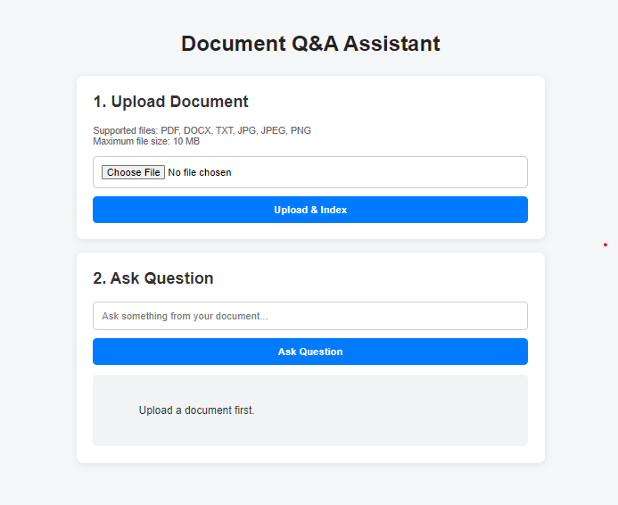
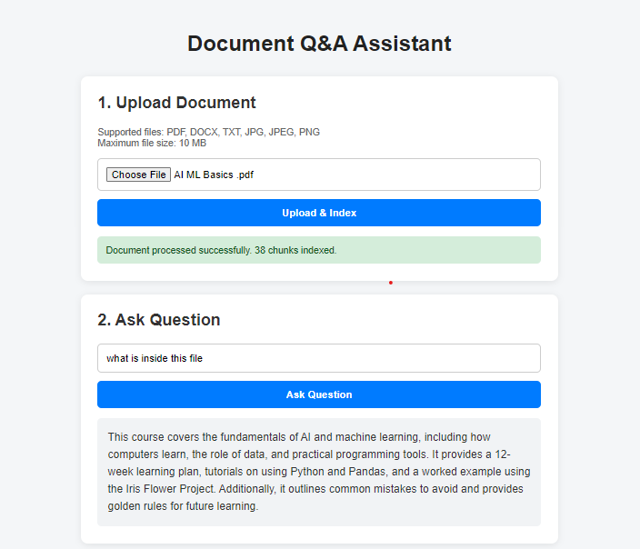

# 🤖 AI-Powered Q&A Assistant

An **AI/ML-based Document Q&A Assistant** that allows users to upload documents and ask questions based on their uploaded files.

The application uses **NLP, embeddings, vector search, and RAG (Retrieval-Augmented Generation)** to retrieve relevant information from documents and generate meaningful answers.

---

## ✨ Features

* 📂 Upload multiple file formats:

  * PDF
  * DOCX
  * TXT
  * JPG
  * JPEG
  * PNG
* 🧩 Automatic text extraction and chunking
* 📊 Displays the number of chunks created
* 🔎 Semantic document search
* 🤖 AI-powered question answering
* 📚 Answers questions based on uploaded documents
* 🌐 Interactive frontend with Flask backend

---

## 🔄 How It Works

```text
Upload File
     ↓
Extract Text
     ↓
Create Chunks
     ↓
Generate Embeddings
     ↓
Store in Vector Database
     ↓
Ask Question
     ↓
Retrieve Relevant Chunks
     ↓
LLM
     ↓
AI Answer
```

---

## 🧠 Technologies Used

| Technology          | Purpose                 |
| ------------------- | ----------------------- |
| Python              | Core development        |
| Flask               | Backend                 |
| HTML/CSS/JavaScript | Frontend                |
| NLP                 | Text processing         |
| Embeddings          | Semantic representation |
| Vector Database     | Document retrieval      |
| LLM                 | Answer generation       |
| RAG                 | Document-based Q&A      |

---

## 📁 Project Structure

```text
Q&A-Assistant/
│
├── backend/
│   ├── app.py
│   └── llm.py
│
├── frontend/
│   ├── index.html
│   └── style.css
│
├── documents/
│
├── chroma_db/
├── .env
├── .gitignore
├── requirements.txt
└── README.md
```

---

## ⚙️ Installation

### 1. Clone Repository

```bash
git clone YOUR_GITHUB_REPOSITORY_URL
cd Q&A-Assistant
```

### 2. Create Virtual Environment

```bash
python -m venv venv
venv\Scripts\activate
```

### 3. Install Dependencies

```bash
pip install -r requirements.txt
```

### 4. Configure API Key

Create a `.env` file:

```env
OPENAI_API_KEY=your_api_key_here
```

> Never upload your `.env` file or API key to GitHub.

---

## ▶️ Run the Project

```bash
python backend/app.py
```

Open:

```text
http://127.0.0.1:5000
```

---

## 💡 Example

Upload a document:

```text
📄 AI_Notes.pdf
✅ File uploaded successfully
🧩 Chunks Created: 25
✅ Document indexed successfully
```

Then ask:

```text
What is Artificial Intelligence?
```

The assistant retrieves relevant information from the uploaded document and provides an AI-generated answer.

---

## 🎯 Learning Outcomes

This project helped me learn and implement:

* AI & Machine Learning
* NLP
* RAG
* Text Chunking
* Embeddings
* Vector Database
* LLM Integration
* Flask Backend
* Frontend & Backend Integration
* Document Processing

---

## 🚀 Future Improvements

* Multiple document chat
* Chat history
* User authentication
* Voice-based questions
* Multilingual support
* Cloud deployment

---

## 👩‍💻 Author

**Harshita**

AI & ML | Python | NLP | RAG | Flask | Full-Stack AI Applications

---

⭐ **If you like this project, consider giving it a star!**




